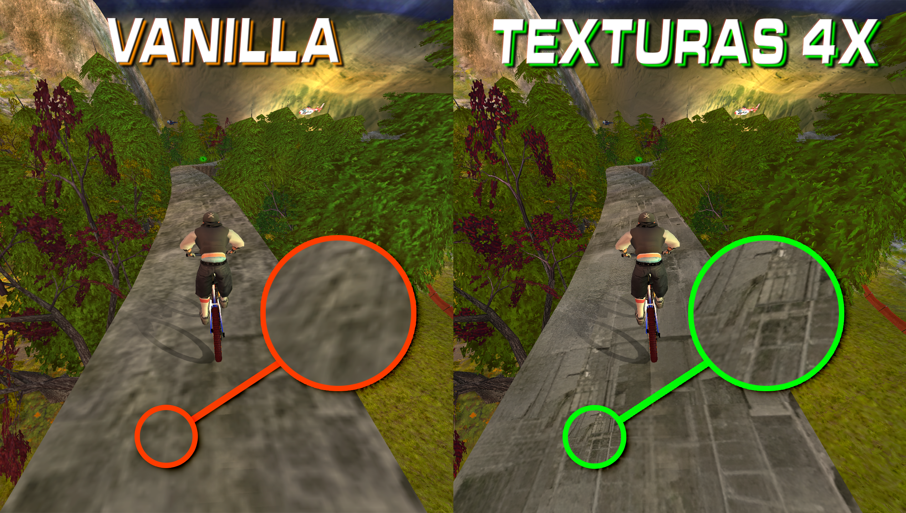

<h2 align="center">Downhill Domination HD Pack</h2>

Redefine el aspecto visual de **Downhill Domination** en PCSX2 o ARMSX2 con paquetes de texturas HD específicos para cada región: 

                              NTSC-U (Norteamérica), PAL (Europa/Brasil/Australia) y NTSC-J (Japón)

<h2 align="center">Comparación visual</h2>

<h2 align="center">Contenido del proyecto</h2>

Las texturas incluidas abarcan los siguientes modos, escenarios y elementos del juego.

### Modos de juego

- Super carrera
- Arcade
- Especializadas
- Time Trial

### Mini juegos

- SuperJump
- Moshbowl
- Trainning

### Modo 2 jugadores

- Mapas individuales
- Dual Slalom
- HUD

### Modo 3 y 4 jugadores

- Mapas individuales
- HUD

### Bonus

- Camelbak
- SparkyTricks

### Bike Shop / Bike Upgrades

- Todas las bicis por default y sus miniaturas
- Piezas intercambiables: Tires, Frames y Forks, incluyendo sus miniaturas

<h2 align="center">Proceso de escalado</h2>

Las texturas fueron escaladas a **4× su resolución original mediante Real-ESRGAN**, incluyendo:

- Texturas principales
- Mipmaps
- LODs de personajes, mapas y elementos misceláneos

<h2 align="center">Versiones regionales</h2>

Cada región cuenta con su propio paquete de texturas extraídas. No se trata simplemente de carpetas renombradas para coincidir con otro ELF.

Aunque utilizar el ELF de otra región y renombrar la carpeta de texturas puede funcionar, aproximadamente un **25–30 % de las texturas podría quedar sin utilizar**. Los paquetes regionales independientes buscan respetar las diferencias de cada versión, incluidos personajes, patrocinios (algunos eliminados según la región) e idiomas.

<h2 align="center">Descargas</h2>

Cada región ofrece dos opciones: descargar el paquete dividido desde GitHub Releases o descargar el archivo completo desde Google Drive.

### Versión Norteamérica

**GitHub Releases**

- [Parte 1 — Texturas-NTSC.zip.001](https://github.com/maggbro/downhilldominationhd/releases/download/PS2NTSC/Texturas-NTSC.zip.001)
- [Parte 2 — Texturas-NTSC.zip.002](https://github.com/maggbro/downhilldominationhd/releases/download/PS2NTSC/Texturas-NTSC.zip.002)

**Google Drive**

- [Descargar paquete completo](https://drive.google.com/file/d/10ugzoDnOqESRzYnxwC5cBfB18IVvYsig/view?usp=sharing)

### Versión Europea

**GitHub Releases**

- [Parte 1 — Texturas-PAL.zip.001](https://github.com/maggbro/downhilldominationhd/releases/download/PS2PAL/Texturas-PAL.zip.001)
- [Parte 2 — Texturas-PAL.zip.002](https://github.com/maggbro/downhilldominationhd/releases/download/PS2PAL/Texturas-PAL.zip.002)

**Google Drive**

- [Descargar paquete completo](https://drive.google.com/file/d/1uOwCwGFccEhrC2vKjARSoXo4Vm05myVx/view?usp=sharing)

### Versión Japonesa

**GitHub Releases**

- [Parte 1 — Texturas-NTSC-J.zip.001](https://github.com/maggbro/downhilldominationhd/releases/download/PS2NTSC-J/Texturas-NTSC-J.zip.001)
- [Parte 2 — Texturas-NTSC-J.zip.002](https://github.com/maggbro/downhilldominationhd/releases/download/PS2NTSC-J/Texturas-NTSC-J.zip.002)

**Google Drive**

- [Descargar paquete completo](https://drive.google.com/file/d/1dv4PtyPkUfQdqDvkNGtaCpX1nPSTjO8w/view?usp=sharing)

> **Importante:** Si descargas desde GitHub Releases, necesitas ambas partes de la región seleccionada para reconstruir el archivo completo. No mezcles partes de regiones diferentes.

Las instrucciones de instalación se encuentran en la publicación de cada versión (*Release*).

## Compatibilidad

- PCSX2
- ARMSX2
